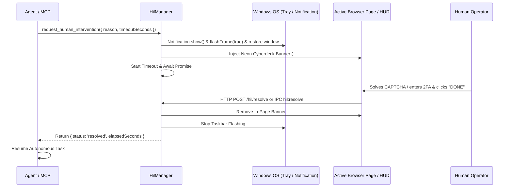

# 🚨 Human-In-The-Loop (HIL) & Notification Subsystem (`src/main/hil/`)

The **HIL & Notification** module provides a cooperative intervention protocol between autonomous AI models and human operators.

---

## 🎯 Purpose

- Autonomous web agents periodically hit roadblocks that require human presence:
  - CAPTCHAs & Cloudflare Turnstile verification.
  - Multi-Factor Authentication (2FA), SMS OTPs, and authenticator codes.
  - Sensitive credential input (passwords, credit cards, billing).
  - Manual security checkpoints or critical action approvals.
- When an agent encounters these checkpoints, rather than failing or hallucinating, it invokes `request_human_intervention`.
- The system alerts the human, unhides/restores the window from the tray, flashes the Windows taskbar, and displays an interactive floating banner in the browser.
- The agent halts execution until the human completes the action and clicks "Resume Agent (Done)" or an MCP tool resolves the request.

---

## 🏗️ Architecture

---

## 🔌 API & MCP Tools

- `request_human_intervention({ reason, timeout_seconds?, bring_to_front? })`: Pauses agent and prompts human.
- `resolve_human_intervention({ id?, notes? })`: Programmatically unblocks pending intervention.
- `get_human_intervention_status()`: Inspects active HIL status and recent resolution history.
- `send_notification({ title, message, urgency?, sound? })`: Dispatches non-blocking desktop notifications.
