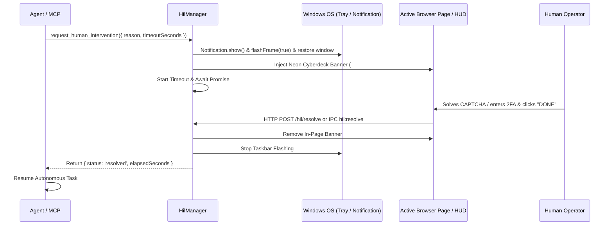

# 🚨 Human-In-The-Loop (HIL) & Notification Subsystem (`src/main/hil/`)

The **HIL & Notification** module provides a cooperative intervention protocol between autonomous AI models and human operators.

---

## 🎯 Purpose

- Autonomous web agents periodically hit roadblocks that require human presence:
  - CAPTCHAs & Cloudflare Turnstile verification.
  - Multi-Factor Authentication (2FA), SMS OTPs, and authenticator codes.
  - Sensitive credential input (passwords, credit cards, billing).
  - Manual security checkpoints or critical action approvals.
- When an agent encounters these checkpoints, rather than failing or hallucinating, it invokes `request_human_intervention`.
- The system alerts the human, unhides/restores the window from the tray, flashes the Windows taskbar, and displays an interactive floating banner in the browser.
- The agent halts execution until the human completes the action and clicks "Resume Agent (Done)" or an MCP tool resolves the request.

---

## 🏗️ Architecture

---

## 🔌 API & MCP Tools

- `request_human_intervention({ reason, timeout_seconds?, bring_to_front? })`: Pauses agent and prompts human.
- `resolve_human_intervention({ id?, notes? })`: Programmatically unblocks pending intervention.
- `get_human_intervention_status()`: Inspects active HIL status and recent resolution history.
- `send_notification({ title, message, urgency?, sound? })`: Dispatches non-blocking desktop notifications.

---

## Who can start an intervention

There are **four** ways the human gets involved, and only the first is the agent asking. They share
the same banner/notification plumbing but have different triggers and different things the agent sees.

| trigger | who starts it | how the agent learns | does the agent block? |
|---|---|---|---|
| `request_human_intervention` | the agent | the tool call resolves when the human resumes | yes — the call is held |
| sensitive gate (age/CAPTCHA/payment/identity) | Kuang, on a `decide`/`drive` call | `409 HUMAN_REQUIRED` + banner already up | no — it gets an error immediately |
| guarded decision under threshold | Kuang, on a `decide` call | `409 HUMAN_DECISION_REQUIRED` + `hil_id`, `options`, `reasons` | no — it is told not to guess |
| **the human grabs the wheel** | the human | `500 HUMAN_IN_PROGRESS` on the next synthetic action | no — input is refused, not queued |

### Voluntary takeover (no banner)

The person does not need permission or a prompt. Any **trusted** pointer/key/wheel/touch event on the
page pauses synthetic input for a 2 s quiet window (extended by further events):

- detection: capture-phase page listener → trusted events only → `__KUANG_HUMAN__:` console channel
- discrimination: the simulator stamps every synthetic dispatch; events inside the 180 ms grace window
  are attributed to the agent (CDP and human input are both trusted, so timing is the only signal)
- effect: `InputSimulator` refuses to act, `AgentStatus` becomes `HUMAN_INPUT`, the HUD shows what was
  touched, and the next `act`/type returns `HUMAN_IN_PROGRESS`
- resume: automatic after quiet, or `POST /human/resume`; `GET /human/status` exposes
  `{active, activeForMs, last:{kind,at,url,target}}`

Full detail: [`../input/README.md`](../input/README.md) and
[`docs/CONTROL_LAYER.md`](../../../docs/CONTROL_LAYER.md#human-takeover).

### Why takeover is separate from HIL

HIL is *the agent admitting it is stuck*. Takeover is *the human disagreeing with the agent's right to
the cursor*. They must not share a queue: an agent waiting on a HIL banner must still yield instantly
when the person starts typing, and a person who simply moves the mouse should never trigger a
banner, a notification, or a taskbar flash.
