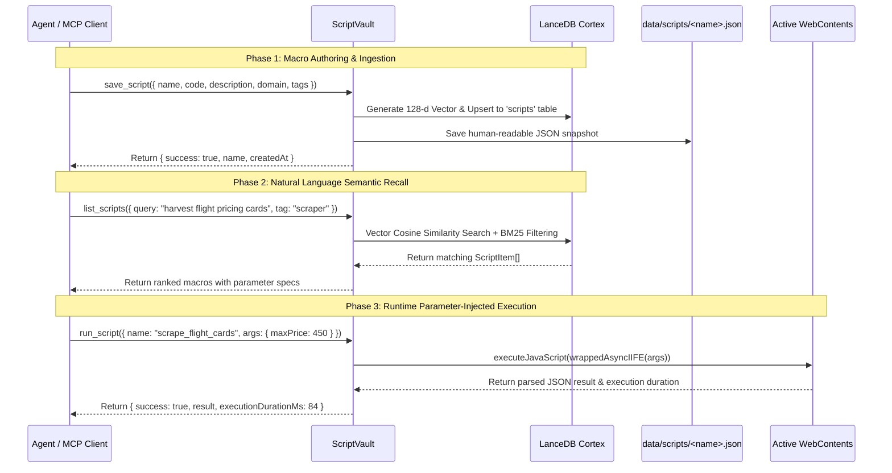

# 💾 Script Vault & Semantic Macro Engine (`src/main/scripts/`)

The **Script Vault** enables autonomous LLM agents to author, persist, semantically recall, and execute custom JavaScript automation routines, scrapers, and DOM macros across browser sessions.

---

## 🎯 Why a Semantic Macro Engine?

1. **Token & Latency Efficiency:** Rather than generating 5–10 sequential tool calls to inspect, scroll, and parse complex web pages, an agent can recall a specialized macro and extract hundreds of structured items in a single turn.
2. **Conversational Semantic Recall:** Every script is vector-embedded into **LanceDB Cortex** using a deterministic 128-dimensional embedding space. Models don't need to memorize exact script names—they search using plain natural language (e.g. *"extract all flight price cards"*, *"unroll Reddit comments tree"*, *"convert HTML table to JSON"*).
3. **Safe Parameter Injection:** Macros accept dynamic JSON parameters (e.g. `{ maxItems: 50, minPrice: 200 }`) injected safely via closure arguments without polluting the global page namespace.
4. **Dual Persistence:** Automatically mirrors scripts to human-readable `.json` files in `data/scripts/<name>.json` while simultaneously indexing them into the LanceDB `scripts` vector table.

---

## 🏗️ Architecture & Execution Flow



---

## ✍️ Macro Authoring Guidelines

Scripts can be written as either an **async arrow function** or a **bare code block**:

### Format A: Async Arrow Function (Recommended)
```javascript
async (args) => {
  const { selector = 'table', maxRows = 100 } = args || {};
  const el = document.querySelector(selector);
  if (!el) return { error: `Element not found: ${selector}` };
  // DOM processing...
  return { count: rows.length, data: rows };
}
```

### Format B: Bare Code Block
```javascript
const maxRows = args.maxRows || 50;
const rows = Array.from(document.querySelectorAll('table tr')).slice(0, maxRows);
return rows.map(r => r.innerText);
```

### Key Authoring Rules:
- **Parameter Access:** Always access arguments through `args` (e.g. `const limit = args.limit || 20;`).
- **Return JSON-Serializable Data:** Ensure return values are plain objects, arrays, strings, numbers, or booleans.
- **Avoid Global Side Effects:** Use `const` and `let` inside the function scope. Do not attach variables to `window` unless deliberately needed across script runs.

---

## 📚 Real-World Macro Examples

### 1. Universal Infinite Scroll & Content Unroller (`infinite_scroll_unroller`)
Gradually scrolls the viewport to trigger dynamic lazy loading, monitoring new DOM mutations until an item threshold or end-of-page is reached.

```javascript
// Macro: infinite_scroll_unroller
// Description: Gradually scrolls page to trigger lazy loading until element count or max scrolls reached.
// Domain: * | Tags: [scroll, lazyload, pagination]
async (args) => {
  const {
    itemSelector = 'article, [role="article"], .post, .item',
    maxScrolls = 8,
    delayMs = 600,
    maxItems = 100
  } = args || {};

  let scrolls = 0;
  let previousHeight = 0;

  while (scrolls < maxScrolls) {
    const currentItems = document.querySelectorAll(itemSelector).length;
    if (currentItems >= maxItems) break;

    const currentHeight = document.documentElement.scrollHeight;
    if (currentHeight === previousHeight && scrolls > 1) {
      // Reached bottom of page
      break;
    }
    previousHeight = currentHeight;

    window.scrollBy({ top: window.innerHeight * 0.85, behavior: 'smooth' });
    await new Promise((r) => setTimeout(r, delayMs));
    scrolls++;
  }

  const finalItems = document.querySelectorAll(itemSelector).length;
  return {
    completedScrolls: scrolls,
    totalItemsDetected: finalItems,
    pageHeight: document.documentElement.scrollHeight
  };
}
```

---

### 2. Universal Table to Clean JSON Converter (`table_to_json`)
Detects any HTML `<table>` or data grid, extracts column headers, normalizes keys to snake_case, and returns an array of structured JSON records.

```javascript
// Macro: table_to_json
// Description: Extracts HTML table rows into clean, structured JSON objects with normalized keys.
// Domain: * | Tags: [table, data, scraper, json]
async (args) => {
  const { tableSelector = 'table', maxRows = 500, skipEmptyRows = true } = args || {};
  const table = document.querySelector(tableSelector);
  if (!table) return { error: `Table not found for selector: ${tableSelector}` };

  // Extract and normalize headers
  const headerCells = Array.from(table.querySelectorAll('thead th, thead td, tr:first-child th'));
  const headers = headerCells.map((th, idx) => {
    const clean = th.innerText.trim().toLowerCase().replace(/[^a-z0-9]+/g, '_').replace(/^_+|_+$/g, '');
    return clean || `column_${idx + 1}`;
  });

  // Extract body rows
  const bodyRows = Array.from(table.querySelectorAll('tbody tr, tr:not(:first-child)'));
  const records = [];

  for (const row of bodyRows.slice(0, maxRows)) {
    const cells = Array.from(row.querySelectorAll('td, th')).map(c => c.innerText.trim());
    if (skipEmptyRows && cells.every(c => c === '')) continue;

    const record = {};
    headers.forEach((header, i) => {
      record[header] = cells[i] !== undefined ? cells[i] : null;
    });
    records.push(record);
  }

  return {
    headers,
    rowCount: records.length,
    records
  };
}
```

---

### 3. Discussion Thread & Comment Tree Harvester (`harvest_discussion_thread`)
Harvests hierarchical discussion threads (Reddit, Hacker News, forums), extracting authors, vote scores, timestamps, and nested reply structures.

```javascript
// Macro: harvest_discussion_thread
// Description: Extracts comments, authors, scores, timestamps, and indent levels from Reddit or Hacker News.
// Domain: news.ycombinator.com, reddit.com | Tags: [comments, discussion, tree]
async (args) => {
  const { maxComments = 60 } = args || {};
  const isHackerNews = window.location.hostname.includes('ycombinator.com');
  const isReddit = window.location.hostname.includes('reddit.com');

  const comments = [];

  if (isHackerNews) {
    const rows = Array.from(document.querySelectorAll('.comment-tree tr.athing.comtr')).slice(0, maxComments);
    for (const r of rows) {
      const id = r.id;
      const indent = r.querySelector('.ind img')?.width ? Math.round(r.querySelector('.ind img').width / 40) : 0;
      const author = r.querySelector('.hnuser')?.innerText.trim() || 'anonymous';
      const age = r.querySelector('.age')?.innerText.trim() || '';
      const text = r.querySelector('.commtext')?.innerText.trim() || '';
      comments.push({ id, level: indent, author, age, text });
    }
  } else if (isReddit) {
    const commentNodes = Array.from(document.querySelectorAll('shreddit-comment, [data-testid="comment"]')).slice(0, maxComments);
    for (const c of commentNodes) {
      const author = c.getAttribute('author') || c.querySelector('[data-testid="comment_author"]')?.innerText.trim() || 'anonymous';
      const score = c.getAttribute('score') || c.querySelector('[id*="vote-count"]')?.innerText.trim() || '0';
      const depth = parseInt(c.getAttribute('depth') || '0', 10);
      const text = c.querySelector('[slot="comment"], .md')?.innerText.trim() || '';
      comments.push({ depth, author, score, text });
    }
  } else {
    // Generic fallback for blog comments
    const genericNodes = Array.from(document.querySelectorAll('.comment, [class*="comment-body"]')).slice(0, maxComments);
    genericNodes.forEach((node, i) => {
      comments.push({ index: i, text: node.innerText.trim() });
    });
  }

  return {
    domain: window.location.hostname,
    commentCount: comments.length,
    comments
  };
}
```

---

### 4. E-Commerce / Travel Price Card Scraper (`scrape_flight_cards`)
Parses dynamic price cards from travel portals (Skyscanner, Google Flights, Kayak), extracting carrier, duration, stops, pricing, and deep booking links.

```javascript
// Macro: scrape_flight_cards
// Description: Extracts airlines, prices, flight times, stops, and links from search results.
// Domain: skyscanner.net, google.com/travel/flights | Tags: [flights, travel, prices]
async (args) => {
  const { maxPrice = null, currency = 'USD', limit = 25 } = args || {};

  const cardSelectors = [
    '[class*="FlightCard"]',
    '[data-testid="flight-card"]',
    '.itinerary-card',
    'li[class*="p-flight"]'
  ];

  let cards = [];
  for (const sel of cardSelectors) {
    cards = Array.from(document.querySelectorAll(sel));
    if (cards.length > 0) break;
  }

  const results = [];
  for (const card of cards.slice(0, limit)) {
    const text = card.innerText;
    const priceMatch = text.match(/(?:[$€£]|USD|EUR|GBP)\s?([0-9,]+)/i);
    const rawPrice = priceMatch ? parseInt(priceMatch[1].replace(/,/g, ''), 10) : null;

    if (maxPrice && rawPrice && rawPrice > maxPrice) continue;

    const link = card.querySelector('a')?.href || window.location.href;
    const airline = card.querySelector('[class*="airline"], [class*="carrier"], img[alt]')?.alt || 'Unknown Airline';

    results.push({
      airline,
      price: rawPrice,
      currency,
      snippet: text.split('\n').filter(s => s.trim().length > 0).slice(0, 4),
      url: link
    });
  }

  return {
    totalParsed: results.length,
    results: results.sort((a, b) => (a.price || 999999) - (b.price || 999999))
  };
}
```

---

### 5. High-Resolution Media Asset Harvester (`extract_media_gallery`)
Scans the DOM for high-resolution images, parses responsive `srcset` attributes and lazy-loaded `data-src` tags, and filters out tracking pixels and UI icons.

```javascript
// Macro: extract_media_gallery
// Description: Filters and resolves high-res image URLs, srcset alternatives, and aspect ratios.
// Domain: * | Tags: [images, gallery, media, harvest]
async (args) => {
  const { minWidth = 200, minHeight = 200, limit = 50 } = args || {};

  const images = Array.from(document.querySelectorAll('img, picture source'));
  const found = new Set();
  const gallery = [];

  for (const el of images) {
    let src = el.src || el.getAttribute('data-src') || el.getAttribute('srcset') || '';
    if (!src) continue;

    // Handle responsive srcset: take the highest resolution entry
    if (src.includes(',')) {
      const candidates = src.split(',').map(s => s.trim().split(' '));
      src = candidates[candidates.length - 1][0];
    }

    if (src.startsWith('//')) src = 'https:' + src;
    if (found.has(src)) continue;

    const width = el.naturalWidth || el.width || parseInt(el.getAttribute('width') || '0', 10);
    const height = el.naturalHeight || el.height || parseInt(el.getAttribute('height') || '0', 10);

    if (width < minWidth || height < minHeight) continue;

    found.add(src);
    gallery.push({
      url: src,
      alt: el.alt || '',
      width,
      height,
      aspectRatio: width && height ? (width / height).toFixed(2) : 'unknown'
    });

    if (gallery.length >= limit) break;
  }

  return {
    totalImages: gallery.length,
    images: gallery
  };
}
```

---

## 🔌 MCP Tools Reference

### 1. `save_script`
Saves a reusable JavaScript routine into the persistent vault and vector index.

**Parameters:**
- `name` *(string, required)*: Unique macro identifier (e.g. `"table_to_json"`).
- `code` *(string, required)*: JavaScript function or code body.
- `description` *(string, optional)*: Natural language description used for semantic vector embedding.
- `domain` *(string, optional)*: Target domain filter (e.g. `"reddit.com"` or `"*"`).
- `tags` *(array of strings, optional)*: Semantic taxonomy keywords (e.g. `["scraper", "tables"]`).

---

### 2. `list_scripts`
Lists registered scripts from the persistent vault, or semantically searches them when a `query` is supplied (ranked by relevance — this replaces the old `recall_script`).

**Parameters:**
- `query` *(string, optional)*: Natural language search term (e.g. `"unroll infinite scroll items"`). When present, results are ranked by relevance.
- `tag` *(string, optional)*: Filter by specific tag.
- `limit` *(number, optional, default: 100)*: Maximum scripts to return.

---

### 3. `run_script`
Executes a vaulted script in the active tab with dynamic runtime parameter injection.

**Parameters:**
- `name` *(string, required)*: Name of the script to execute.
- `args` *(object, optional)*: Key-value parameters passed into the macro's `args` parameter.

**Output:**
```json
{
  "success": true,
  "name": "table_to_json",
  "result": {
    "headers": ["flight_id", "departure", "destination", "price_usd"],
    "rowCount": 4,
    "records": [...]
  },
  "executionDurationMs": 42
}
```

---

### 4. `delete_script`
Permanently deletes a script from both LanceDB Cortex and the `data/scripts/` filesystem.

**Parameters:**
- `name` *(string, required)*: Name of the script to delete.

---

## 🌐 Local HTTP Bridge API Examples

The Autonomous HTTP Bridge runs on `http://127.0.0.1:4111`. You can interact with the Script Vault from external bash scripts, curl, or Python:

### Save Macro via `curl`:
```bash
curl -X POST http://127.0.0.1:4111/scripts/save \
  -H "Content-Type: application/json" \
  -d '{
    "name": "extract_titles",
    "description": "Extracts all H1 and H2 headings from the current document",
    "code": "return Array.from(document.querySelectorAll(\"h1, h2\")).map(h => h.innerText.trim());",
    "tags": ["headings", "seo"]
  }'
```

### Semantic Search via `curl`:
```bash
curl -X POST http://127.0.0.1:4111/scripts/recall \
  -H "Content-Type: application/json" \
  -d '{
    "query": "get all page headings and titles",
    "limit": 3
  }'
```

### Execute Macro with Parameters via `curl`:
```bash
curl -X POST http://127.0.0.1:4111/scripts/run \
  -H "Content-Type: application/json" \
  -d '{
    "name": "infinite_scroll_unroller",
    "args": {
      "maxScrolls": 5,
      "delayMs": 400
    }
  }'
```
