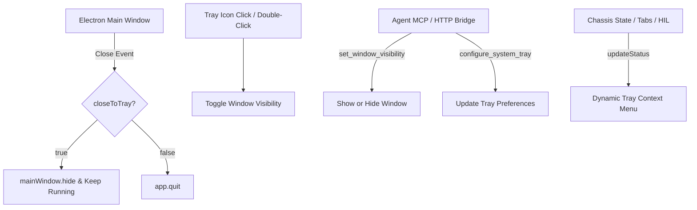

# 🗔 System Tray & Desktop Visibility Subsystem (`src/main/tray/`)

The **System Tray** module manages background desktop lifecycle, system tray icons, and window visibility for the Kuang Grade Mark Eleven Cyberdeck.

---

## 🎯 Purpose

- Keeps the Cyberdeck window completely out of the user's way during long-running automated tasks, batch scrapes, and research pipelines.
- Sits in the Windows Notification Area (System Tray) with custom high-contrast Mark Eleven insignia.
- Provides a fast toggle to minimize/hide the window or summon/restore it with a single tray click.
- Supports **Close-to-Tray** behavior so closing the window keeps active sessions and MCP uplinks alive in the background.

---

## 🏗️ Architecture

---

## 🔌 API & MCP Tools

- `set_window_visibility({ visible: boolean })`: Minimizes to tray (`false`) or restores to screen (`true`).
- `configure_system_tray({ close_to_tray?: boolean })`: Toggles close-to-tray background minimization.
